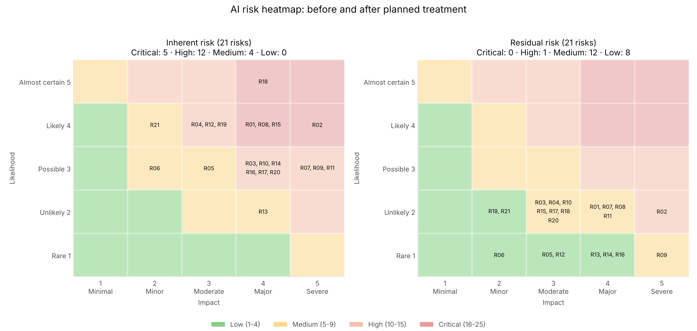

# AI Governance Risk Assessment: Healthcare SaaS Company

An AI governance assessment of a fictional healthcare SaaS company, **Bluefin Health Analytics**, using three frameworks: the **NIST AI Risk Management Framework**, **ISO/IEC 42001**, and the **EU AI Act** (as amended by the 2026 Digital Omnibus). It includes an AI system inventory, EU AI Act risk classification, a 21-risk AI risk register, maturity assessments, an **AI Acceptable Use Policy**, and an **AI use case intake form**.

> ⚠️ **Disclaimer:** Bluefin Health Analytics is a fictional organization created for this portfolio project. All systems, findings, and evidence are simulated. Regulatory information reflects public sources as of November 2026 and is not legal advice.

This project builds on my [NIST CSF 2.0 Gap Assessment](https://github.com/trishannramirez/nist-csf-gap-analysis) of the same company.



## Key results

| Metric | Result |
|---|---|
| AI systems inventoried | **6** (3 built in-house, 3 third-party) |
| AI risks identified | **21**: 5 Critical, 12 High, 4 Medium |
| After planned treatment | 0 Critical, 1 High, 12 Medium, 8 Low (57% lower total risk score) |
| NIST AI RMF maturity | **1.16 / 5** → target 2.95 (weakest: Measure, 0.75) |
| ISO/IEC 42001 readiness | **0.94 / 5** → target 3.00 |
| EU AI Act findings | 1 prohibited feature in use, 2 high-risk systems (1 pending determination), 1 transparency obligation |

**Bottom line:** Bluefin uses AI in six places, including a model that influences which patients receive follow-up care, and none of it is governed. The most urgent issues are shadow AI (31% of staff use personal AI accounts), a prohibited emotion-recognition feature in a sales tool, and an unresolved question of whether the readmission model is a regulated medical device.

## Repository contents

```
.
├── README.md
├── docs/
│   ├── 01-executive-summary.md                 # Board-ready summary and decisions requested
│   ├── 02-context-and-regulatory-landscape.md  # Scope, frameworks, EU and US regulatory timeline
│   ├── 03-ai-system-inventory-and-classification.md  # 6 AI systems and EU AI Act tiers with rationale
│   ├── 04-nist-ai-rmf-assessment.md            # 19-category maturity assessment
│   ├── 05-iso-42001-gap-assessment.md          # Clause and Annex A readiness
│   ├── 06-ai-risk-register.md                  # Methodology, heatmaps, top risks, OWASP mapping
│   └── 07-roadmap.md                           # Phased plan tied to regulatory deadlines
├── policies/
│   └── ai-acceptable-use-policy.md             # Ready-to-adopt AI acceptable use policy
├── templates/
│   └── ai-use-case-intake-form.md              # Intake and EU AI Act screening form for new AI
├── data/
│   ├── ai_system_inventory.csv
│   ├── ai_risk_register.csv                    # 21 risks mapped to NIST AI RMF, ISO 42001, EU AI Act, OWASP
│   ├── nist_ai_rmf_assessment.csv
│   └── iso42001_gap_assessment.csv
├── scripts/
│   ├── analyze.py                              # Validates data, scores risks, builds charts
│   └── requirements.txt
└── outputs/
    ├── scored_risk_register.csv
    ├── risk_by_system.csv
    ├── nist_ai_rmf_function_summary.csv
    ├── risk_heatmap.png
    ├── nist_ai_rmf_maturity.png
    └── iso42001_readiness.png
```

## Where to start

| If you are… | Read |
|---|---|
| A hiring manager with 2 minutes | [Executive Summary](docs/01-executive-summary.md) |
| Interested in the EU AI Act | [AI Inventory and Classification](docs/03-ai-system-inventory-and-classification.md) |
| A risk practitioner | [AI Risk Register](docs/06-ai-risk-register.md) and [`data/ai_risk_register.csv`](data/ai_risk_register.csv) |
| Looking for reusable artifacts | [AI Acceptable Use Policy](policies/ai-acceptable-use-policy.md) and [AI Use Case Intake Form](templates/ai-use-case-intake-form.md) |

## AI systems assessed

| ID | System | EU AI Act tier |
|---|---|---|
| AI-01 | Bluefin Assist (internal GenAI assistant) | Minimal |
| AI-02 | Support Copilot (customer chatbot) | Transparency (Art. 50) |
| AI-03 | ReadmitIQ (readmission risk prediction) | Likely high-risk via Annex I, pending determination |
| AI-04 | StaffSense (patient volume forecasting) | Minimal (high-risk if extended to individual workers) |
| AI-05 | Vendor AI features (note-taker, coding assistant, call intelligence) | Contains a prohibited feature (Art. 5(1)(f)) |
| AI-06 | ATS candidate ranking | High-risk (Annex III), Bluefin as deployer |

## Methodology in brief

1. **Inventory:** found every AI system Bluefin builds, buys, or has enabled inside other software.
2. **Classify:** applied the EU AI Act's prohibited → high-risk → transparency → minimal logic, plus US considerations (HIPAA, HHS Section 1557, Colorado SB 26-189, NYC Local Law 144, FDA).
3. **Assess maturity:** scored the 19 NIST AI RMF categories and the ISO/IEC 42001 clauses and Annex A objectives on a 0–5 scale.
4. **Assess risk:** 5×5 likelihood × impact scoring of inherent and residual risk against a defined risk appetite (residual ≤ 9).
5. **Plan:** a phased roadmap tied to EU AI Act dates and the company's EU pilot.

## Reproduce the analysis

```bash
pip install -r scripts/requirements.txt
python scripts/analyze.py
```

The script validates the data (unique IDs, valid scores, known systems, all 19 AI RMF categories), scores the risk register, and regenerates everything in `outputs/`.

## Skills demonstrated

- **AI governance frameworks:** NIST AI RMF 1.0 and Generative AI Profile (AI 600-1), ISO/IEC 42001:2023, EU AI Act including the 2026 Digital Omnibus changes
- **Regulatory analysis:** provider vs. deployer roles, high-risk classification, prohibited practices, US federal and state AI rules in healthcare and hiring
- **AI risk management:** inherent and residual scoring, risk appetite, risk acceptance, OWASP Top 10 for LLM Applications
- **Policy writing:** a practical AI Acceptable Use Policy and intake process
- **Executive communication:** clear decisions requested, tied to deadlines
- **Automation:** Python (pandas, matplotlib) for validation, scoring, and visualization

## References

- NIST AI 100-1, *Artificial Intelligence Risk Management Framework (AI RMF 1.0)*, 2023. https://www.nist.gov/itl/ai-risk-management-framework
- NIST AI 600-1, *Generative Artificial Intelligence Profile*, 2024
- ISO/IEC 42001:2023, *Information technology — Artificial intelligence — Management system*
- Regulation (EU) 2024/1689 (Artificial Intelligence Act), as amended by Regulation (EU) 2026/1744 (Digital Omnibus on AI)
- OWASP, *Top 10 for LLM Applications 2025*
- HHS Office for Civil Rights, Section 1557 final rule, 45 CFR 92.210

## Author

**Trish Ann Ramirez** – Aspiring GRC / Cybersecurity Analyst
[LinkedIn](https://www.linkedin.com/in/your-profile)
