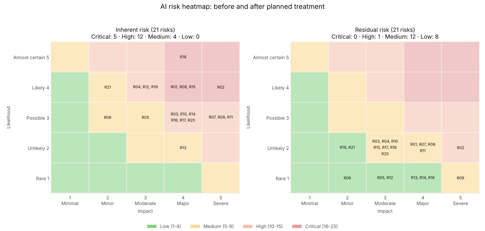

# 01 – Executive Summary

**To:** CEO, Executive Team, and Board of Directors, Bluefin Health Analytics (fictional)
**From:** GRC Analyst
**Subject:** AI Governance Risk Assessment (NIST AI RMF, ISO/IEC 42001, EU AI Act)
**Date:** November 2026

---

## Bottom line

Bluefin uses AI in **six places**, including a model that influences **which patients receive follow-up care**. None of them is governed. There is no AI policy, no owner, no monitoring, and no risk review before launch. Meanwhile, **31% of employees use personal AI accounts for work**, which could put PHI into tools with no BAA.

The EU expansion in 2027 makes this urgent. **One AI feature already in use is a prohibited practice under the EU AI Act**, the customer chatbot is subject to transparency rules **in force since August 2026**, and ReadmitIQ may be a **high-risk AI system** whose regulatory status nobody has determined.

The issues are fixable. **Most Phase 1 actions are policy and configuration changes, not new tools**, and they can be done by the end of January 2027.

## Results at a glance

| Measure | Result |
|---|---|
| AI systems inventoried | **6** (3 built, 3 bought) |
| AI risks identified | **21**: 5 Critical, 12 High, 4 Medium |
| Risks after planned treatment | 0 Critical, 1 High, 12 Medium, 8 Low (**57%** lower total risk score) |
| NIST AI RMF maturity | **1.16 / 5** (target 2.95). Weakest function: **Measure** (0.75) |
| ISO/IEC 42001 readiness | **0.94 / 5** (target 3.00). Not certification-ready; 12–18 months with the roadmap |

## EU AI Act classification

| System | Tier | Action |
|---|---|---|
| Sales call platform (voice emotion analysis) | 🔴 **Prohibited feature** (Art. 5(1)(f)) | Disable by 31 Dec 2026 |
| ReadmitIQ (readmission risk) | 🟠 **Likely high-risk** via Annex I, *pending regulatory determination* | Legal determination before the EU pilot |
| ATS candidate ranking | 🟠 **High-risk** (Annex III), Bluefin as deployer | Deployer controls by 2 Dec 2027 |
| Support Copilot (chatbot) | 🟡 **Transparency** (Art. 50) | AI disclosure now |
| Bluefin Assist, StaffSense | 🟢 Minimal | AI literacy; control StaffSense roadmap |

## Five things leadership needs to know

1. **Shadow AI is the most likely way AI causes a breach** (R02, score 20). Even after controls it stays above our risk appetite, so it needs formal risk acceptance and ongoing monitoring.
2. **ReadmitIQ carries the most risk** (7 of 21 risks). It may under-predict risk for underserved patients (R07), its accuracy is not monitored (R08), and the legal basis for training it on PHI from 12 customers is undocumented (R09).
3. **Our customers need answers we can't give yet.** Hospitals must perform due diligence on decision support tools under HHS Section 1557 rules. Without a model facts sheet (R12), AI questions will slow deals and renewals.
4. **Vendors are adding AI without asking us** (R15). Meeting note-takers record customer calls, and one vendor feature is prohibited in the EU.
5. **Nobody owns AI risk** (R18). This is the root cause behind most other findings.

## Decisions requested

1. **Approve** the [AI Acceptable Use Policy](../policies/ai-acceptable-use-policy.md) and the approved AI tools list.
2. **Charter** an AI Governance Committee (CISO as chair; VP Product, General Counsel, Privacy, Data Science, clinical advisor).
3. **Fund** outside regulatory counsel for the ReadmitIQ medical device determination, plus model monitoring tooling.
4. **Accept** the residual shadow AI risk (R02) for 12 months, with quarterly reporting.
5. **Make** resolution of R05, R08, and R11 a go-live condition for the Netherlands pilot.

## Roadmap summary

| Phase | Timing | Focus |
|---|---|---|
| **1 – Stop the bleeding** | By 31 Jan 2027 | Disable prohibited feature, AI policy, block shadow AI, governance committee, chatbot disclosure, training data legal review |
| **2 – Build foundations** | Feb–Apr 2027 | ReadmitIQ regulatory determination, bias testing, monitoring, model facts sheet; chatbot red teaming; vendor AI controls; AI literacy training |
| **3 – Operate and certify** | May 2027 onward | AI incident response, ATS deployer obligations, impact assessments, ISO/IEC 42001 certification |

Full plan: [07-roadmap.md](07-roadmap.md)
