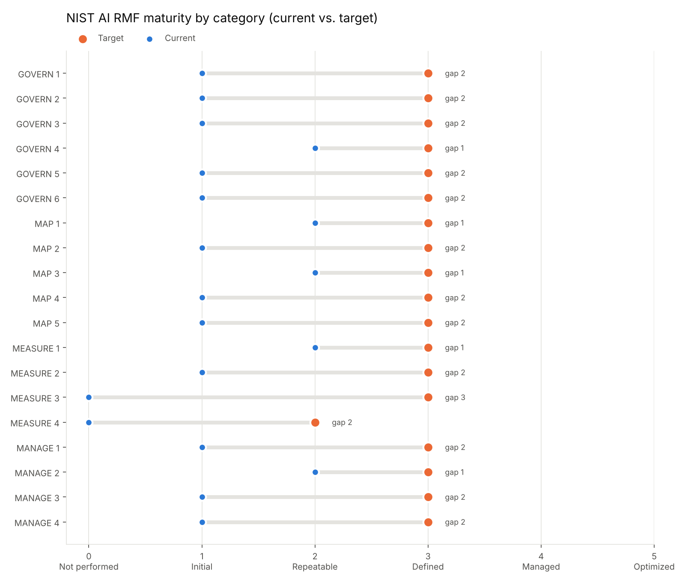

# 04 – NIST AI RMF Maturity Assessment

## Method

The NIST AI Risk Management Framework (AI RMF 1.0) organizes AI risk outcomes into four functions (**Govern, Map, Measure, Manage**), 19 categories, and 72 subcategories. This assessment scores Bluefin at the **category level** (19 categories) using the same 0–5 maturity scale as the [CSF 2.0 assessment](https://github.com/trishannramirez/nist-csf-gap-analysis):

| 0 | 1 | 2 | 3 | 4 | 5 |
|---|---|---|---|---|---|
| Not performed | Initial | Repeatable | Defined | Managed | Optimized |

For generative AI systems (Bluefin Assist and Support Copilot), the assessment also considered the risks highlighted in the **NIST Generative AI Profile (AI 600-1)**, including confabulation, data privacy, and information security.

The target for most categories is **3 (Defined)**. Measure 4 targets **2**, because measuring how well the metrics themselves work is a later-stage practice.

Full data: [`data/nist_ai_rmf_assessment.csv`](../data/nist_ai_rmf_assessment.csv)

## Results by function

| Function | Categories | Current avg. | Target avg. | Summary |
|---|---|---|---|---|
| **Govern** | 6 | 1.17 | 3.00 | No AI policy, no owner, no AI committee, no third-party AI review |
| **Map** | 5 | 1.40 | 3.00 | Intended use partly documented for ReadmitIQ only; no risk tiering or impact assessments |
| **Measure** | 4 | **0.75** | 2.75 | **Weakest function.** No production monitoring, no red teaming, one fairness check in 2024 |
| **Manage** | 4 | 1.25 | 3.00 | Feature flags exist, but no release gates, AI incident playbooks, or control over vendor model upgrades |
| **Overall** | 19 | **1.16** | 2.95 | |

## Key findings

### Govern: nobody owns AI risk
- **GOVERN 1 (1 → 3):** There is no AI policy and no acceptable use policy. Combined with the 31% shadow AI rate, this is the root cause of the two highest-scoring risks in the register (R02, R18).
- **GOVERN 2 (1 → 3):** The data science lead informally owns ReadmitIQ. No one owns AI risk across the company.
- **GOVERN 3 (1 → 3):** ReadmitIQ was designed by three data scientists without clinical, legal, or patient perspectives. For a tool that decides who gets follow-up care, that is a significant gap.
- **GOVERN 6 (1 → 3):** No AI system from a third party was ever reviewed, including the LLM behind Support Copilot and the ATS ranking feature.

### Map: risks are not identified before deployment
- **MAP 2 (1 → 3):** No AI system had been classified, for risk or for regulation, before this assessment.
- **MAP 4 (1 → 3):** The legal basis for training ReadmitIQ on PHI from 12 customers is undocumented (risk R09).
- **MAP 5 (1 → 3):** No impact assessment considers how errors affect patients or specific groups.

### Measure: no visibility after launch
- **MEASURE 2 (1 → 3):** One fairness check in 2024. Support Copilot has never been red-teamed against prompt injection or data leakage.
- **MEASURE 3 (0 → 3):** No monitoring for drift or performance decay. If ReadmitIQ's accuracy dropped, Bluefin would not know (risk R08).
- **MEASURE 4 (0 → 2):** No check of whether the metrics reflect real-world outcomes.

### Manage: limited ability to respond
- **MANAGE 2 (2 → 3):** Support Copilot can be switched off with a feature flag, which is a real strength. There are no documented release gates or rollback procedures.
- **MANAGE 3 (1 → 3):** The LLM provider's model updates flow into production automatically (risk R21).
- **MANAGE 4 (1 → 3):** The incident response plan has no AI scenarios (risk R20).

## Strengths
- A feature flag can disable Support Copilot immediately.
- Engineering has a blameless postmortem culture to build on (GOVERN 4).
- ReadmitIQ has a documented intended use and launch accuracy metrics (MAP 1, MEASURE 1).
