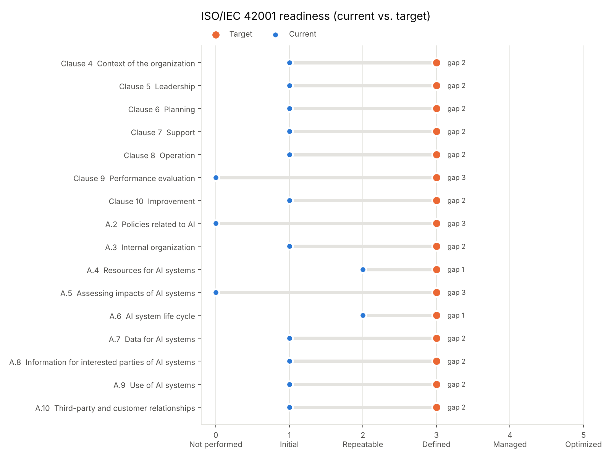

# 05 – ISO/IEC 42001 Readiness Assessment

## Method

ISO/IEC 42001:2023 is the international standard for an **AI management system (AIMS)**. Like ISO 27001, it has management system clauses (4–10) that are all mandatory for certification, plus an Annex A of AI-specific control objectives and controls. These are selected through a Statement of Applicability.

This readiness review scores the **7 clauses** and the **9 Annex A control objective areas (A.2–A.10)** on the 0–5 maturity scale. A score of **3 (Defined)** is roughly the level needed to pass a certification audit.

Full data: [`data/iso42001_gap_assessment.csv`](../data/iso42001_gap_assessment.csv)

> The descriptions below summarize each area in my own words. The standard itself is copyrighted and available from ISO.

## Results

**Average current maturity: 0.94 / 5. Target: 3.00.** Bluefin is **not ready for certification**. With the roadmap in [07](07-roadmap.md), a certification audit would be realistic in about **12–18 months**.

### Management system clauses

| Clause | Current → Target | Main gap |
|---|---|---|
| 4 Context of the organization | 1 → 3 | No AIMS scope; Bluefin's provider and deployer roles undefined |
| 5 Leadership | 1 → 3 | No AI policy; no executive accountability |
| 6 Planning | 1 → 3 | No AI risk assessment, risk treatment, or AI system impact assessment process |
| 7 Support | 1 → 3 | No AI competence requirements or awareness program |
| 8 Operation | 1 → 3 | AI follows the general SDLC with no AI-specific controls |
| 9 Performance evaluation | **0** → 3 | No AI monitoring, internal audit, or management review |
| 10 Improvement | 1 → 3 | No corrective action process for AI issues |

### Annex A control objectives

| Area | Current → Target | Main gap |
|---|---|---|
| A.2 Policies related to AI | **0** → 3 | No AI policy |
| A.3 Internal organization | 1 → 3 | No AI roles; no channel to raise AI concerns |
| A.4 Resources for AI systems | 2 → 3 | Technical resources documented; people and competence not |
| A.5 Assessing impacts of AI systems | **0** → 3 | No impact assessments |
| A.6 AI system life cycle | 2 → 3 | Good SDLC basics; no ML validation criteria, release gates, or monitoring |
| A.7 Data for AI systems | 1 → 3 | Training data provenance and de-identification undocumented |
| A.8 Information for interested parties | 1 → 3 | No model documentation or AI incident communication |
| A.9 Use of AI systems | 1 → 3 | No acceptable use rules |
| A.10 Third-party and customer relationships | 1 → 3 | No AI supplier requirements; responsibilities with customers not allocated |

## How 42001 builds on existing work

Bluefin is already working toward ISO 27001-style controls and a SOC 2 report (see the [CSF 2.0 roadmap](https://github.com/trishannramirez/nist-csf-gap-analysis)). The two standards share the same clause structure, so Bluefin can reuse:
- document control, internal audit, management review, and corrective action processes (Clauses 7, 9, 10)
- the risk methodology and risk register (Clause 6)
- the vendor risk program (A.10)

**Recommendation:** run an integrated ISMS + AIMS rather than two separate programs.

## Statement of Applicability, initial view

All Annex A areas apply to Bluefin, because it is both a provider and a deployer. No areas are proposed for exclusion. Individual controls will be confirmed when the AI risk treatment plan is finalized.
