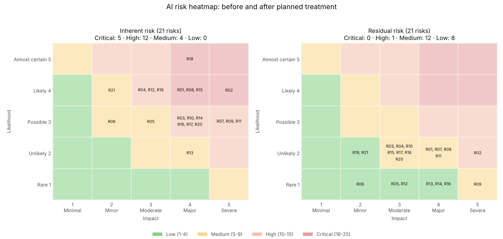

# 06 – AI Risk Register

The register contains **21 risks** across the 6 AI systems and the organization as a whole. Each risk is mapped to the NIST AI RMF, ISO/IEC 42001, the EU AI Act, and, for generative AI, the OWASP Top 10 for LLM Applications (2025).

- Source data: [`data/ai_risk_register.csv`](../data/ai_risk_register.csv)
- Scored output: [`outputs/scored_risk_register.csv`](../outputs/scored_risk_register.csv)

## Scoring method

**Risk score = Likelihood (1–5) × Impact (1–5)**

| Likelihood | | Impact | |
|---|---|---|---|
| 1 Rare | < once in 5 years | 1 Minimal | No meaningful harm |
| 2 Unlikely | Once in 2–5 years | 2 Minor | Limited, quickly corrected |
| 3 Possible | About once a year | 3 Moderate | Customer impact, contract issue, or a small number of patients affected |
| 4 Likely | Several times a year | 4 Major | Regulatory finding, patient harm, or loss of key customers |
| 5 Almost certain | Expected or already occurring | 5 Severe | Reportable breach, serious patient harm, or major fines |

| Rating | Score | Required action |
|---|---|---|
| **Critical** | 16–25 | Immediate treatment; executive visibility |
| **High** | 10–15 | Treatment plan within 30 days; CISO acceptance if above appetite |
| **Medium** | 5–9 | Treat or accept within the AI Governance Committee's authority |
| **Low** | 1–4 | Monitor |

**Risk appetite:** residual risk must be **9 or below (Medium)**. Anything higher needs formal, time-limited risk acceptance by the CISO and General Counsel.

**Inherent** risk is the current state, with existing controls. **Residual** risk is the expected state after the planned treatment is in place.

## Results

| | Critical | High | Medium | Low | Total score |
|---|---|---|---|---|---|
| **Inherent** | 5 | 12 | 4 | 0 | 272 |
| **Residual (after treatment)** | 0 | 1 | 12 | 8 | 117 |

The planned treatments reduce total risk score by **57%** and eliminate all Critical risks. One risk remains above appetite after treatment (see below).

## Top risks by inherent score

| ID | System | Risk | Inherent | Residual | Owner |
|---|---|---|---|---|---|
| R02 | Bluefin Assist | Shadow AI with personal accounts | **20** Critical | 10 High | CISO |
| R18 | Organization | No AI governance or inventory process | **20** Critical | 6 Medium | CISO |
| R01 | Bluefin Assist | PHI entered into internal AI assistant | **16** Critical | 8 Medium | CTO |
| R08 | ReadmitIQ | Model drift and performance decay | **16** Critical | 8 Medium | Data Science Lead |
| R15 | Vendor AI | Vendor AI features exposing data | **16** Critical | 6 Medium | GRC / Procurement |
| R07 | ReadmitIQ | Algorithmic bias in readmission scores | 15 High | 8 Medium | VP Product |
| R09 | ReadmitIQ | Unclear rights to use training data | 15 High | 5 Medium | General Counsel |
| R11 | ReadmitIQ | Regulatory misclassification | 15 High | 8 Medium | General Counsel |

## Risk concentration by system

| System | Risks | Highest inherent | Avg. inherent → residual |
|---|---|---|---|
| AI-03 ReadmitIQ | 7 | 16 | 13.3 → 6.0 |
| AI-02 Support Copilot | 5 | 12 | 9.4 → 4.2 |
| Organization-wide | 3 | 20 | 14.7 → 5.3 |
| AI-01 Bluefin Assist | 2 | 20 | 18.0 → 9.0 |
| AI-05 Vendor AI features | 2 | 16 | 14.0 → 5.0 |
| AI-04 StaffSense | 1 | 12 | 12.0 → 4.0 |
| AI-06 ATS candidate ranking | 1 | 12 | 12.0 → 6.0 |

**ReadmitIQ carries the most risk.** It is the only system that directly influences patient care, it was trained on customer PHI, and its regulatory status is unresolved.

## Risk above appetite after treatment

**R02 Shadow AI (residual 10, High).** Blocking unapproved AI services and offering Bluefin Assist will reduce how often it happens, but the impact of PHI going into a consumer AI tool stays **Severe** (a potentially reportable HIPAA breach). Consumer AI services change constantly, so no technical control will catch everything.

**Recommendation:** The CISO and General Counsel formally accept the residual risk for 12 months. Conditions: quarterly shadow AI discovery reports, and re-scoring if detected usage does not fall below 5% of staff within 6 months.

## Risks by category

| Category | Risks |
|---|---|
| Compliance | R05, R09, R11, R14, R16, R19 |
| Safety / Reliability | R04, R08, R10 |
| Privacy | R01, R02 |
| Security | R03, R13 |
| Fairness | R07, R17 |
| Third-party | R15, R21 |
| Operational | R06, R20 |
| Transparency | R12 |
| Governance | R18 |

## Generative AI threats covered (OWASP Top 10 for LLM Applications, 2025)

| OWASP ID | Threat | Register |
|---|---|---|
| LLM01 | Prompt Injection | R03 |
| LLM02 | Sensitive Information Disclosure | R01 |
| LLM03 | Supply Chain | R15, R21 |
| LLM06 | Excessive Agency | R03 |
| LLM07 | System Prompt Leakage | R03 |
| LLM09 | Misinformation | R04 |
| LLM10 | Unbounded Consumption | R06 |

LLM04 (Data and Model Poisoning), LLM05 (Improper Output Handling), and LLM08 (Vector and Embedding Weaknesses) were considered and rated low for now. Support Copilot retrieves only Bluefin-authored public help articles, and its output is shown as text, not executed. They should be reassessed if retrieval expands to customer-provided content.
